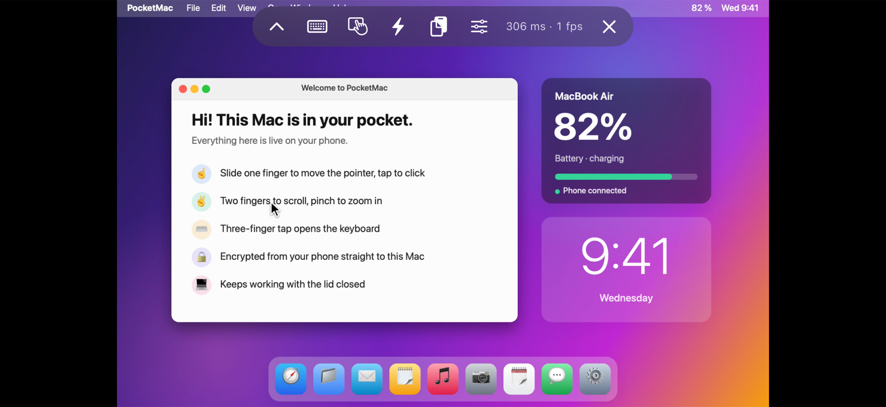
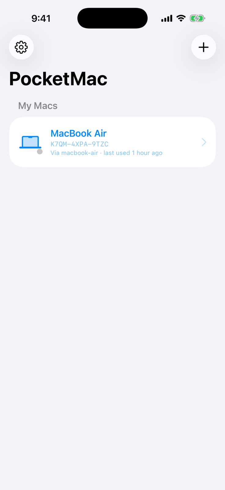
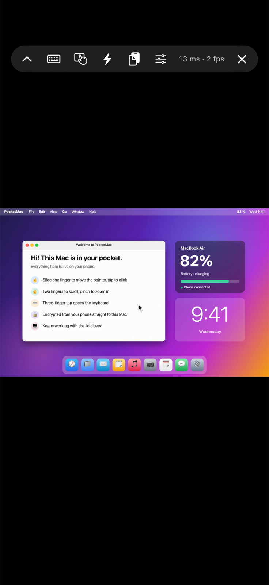
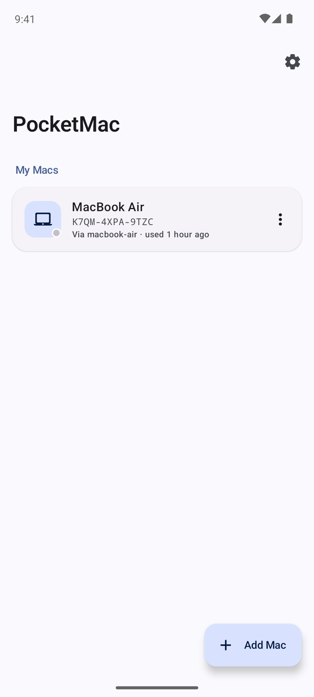
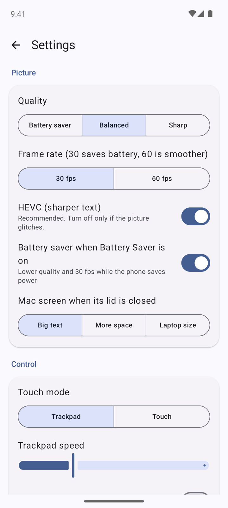
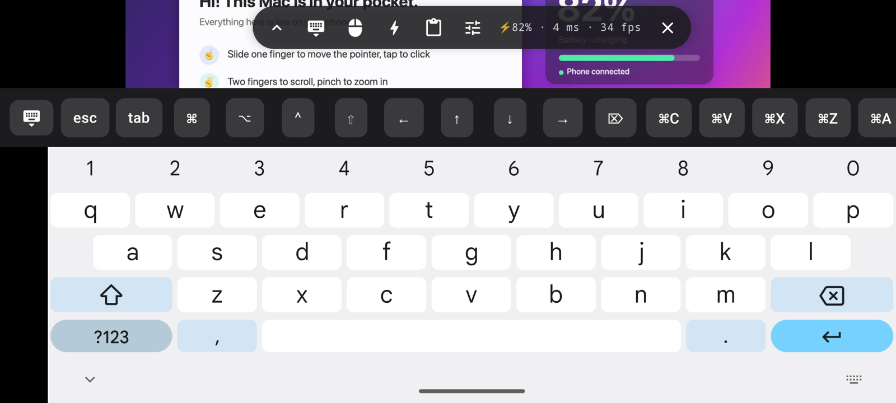
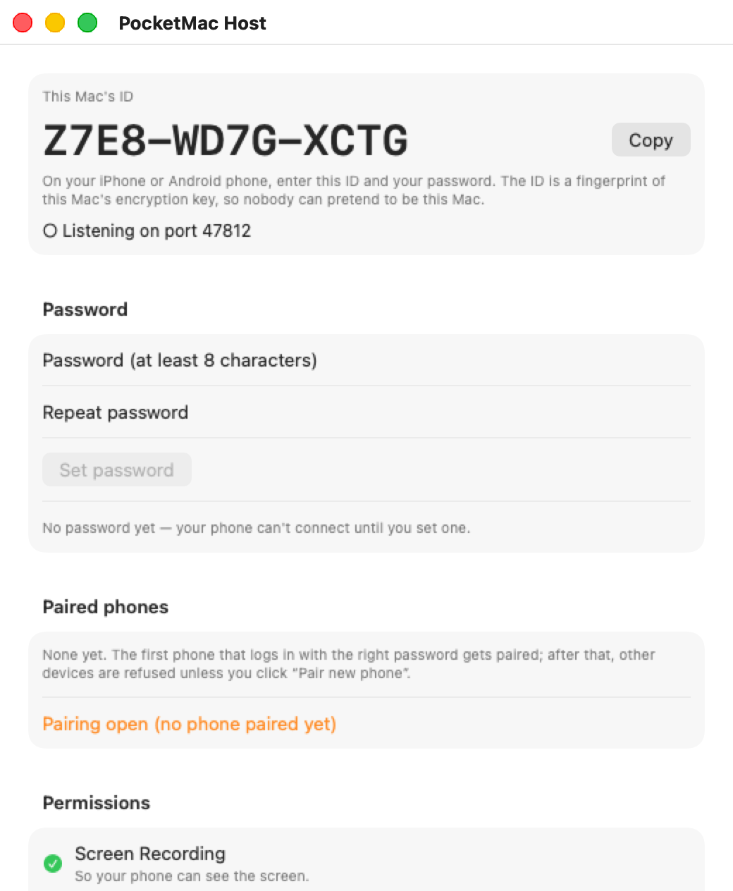
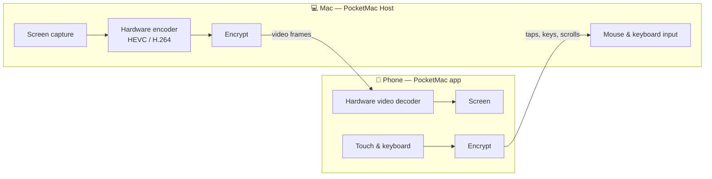

<div align="center">


# PocketMac

**Control your Mac from your phone.**<br>
See the screen live, click, scroll and type with touch — even with the lid closed.<br>
Private by design: end-to-end encrypted, straight from your phone to your Mac. No account, no cloud.

[](https://github.com/Its-Choudhary/pocketmac/releases/latest)
[](https://github.com/Its-Choudhary/pocketmac/actions/workflows/build-mac.yml)
[](https://github.com/Its-Choudhary/pocketmac/actions/workflows/build-ios.yml)
[](https://github.com/Its-Choudhary/pocketmac/actions/workflows/build-android.yml)
[](LICENSE)



</div>

---

## Contents

1. [What you get](#what-you-get)
2. [Download](#download)
3. [Set up in 3 steps](#set-up-in-3-steps-about-10-minutes)
4. [Use it from anywhere with Tailscale](#use-it-from-anywhere-with-tailscale)
5. [How to use it](#how-to-use-it)
6. [Is it safe?](#is-it-safe)
7. [How it works](#how-it-works)
8. [Help, something's wrong](#help-somethings-wrong)
9. [Build it yourself & contribute](#build-it-yourself--contribute)

---

## What you get

| | |
|---|---|
| 🖥️ **Live screen** | Your Mac's screen on your phone, smooth and sharp (hardware video, 30 or 60 fps). |
| 👆 **Touch control** | Use the phone like a trackpad, or tap exactly where you want to click. |
| ⌨️ **Full keyboard** | Any language, plus a shortcut bar: Esc, Tab, ⌘ ⌥ ⌃ ⇧, arrows, ⌘C / ⌘V, F1–F12. |
| 💻 **Lid closed** | Keeps working with the Mac's lid closed, on a screen shaped like your phone. |
| 📋 **Shared clipboard** | Copy on the Mac, paste on the phone, and back. |
| ⚡ **Quick actions** | Lock, sleep, Spotlight, Mission Control, volume, play/pause, screenshot… |
| 🔒 **Private** | End-to-end encrypted. Only phones you pair can connect. Your Mac's screen goes dark while you're connected. |
| 🌍 **From anywhere** | At home it just works. Away from home, add the free Tailscale app. |
| 🔋 **Light on battery** | When nothing moves on screen, nothing is sent. The Mac app uses ~0% CPU while waiting. |

Works with an **iPhone** (iOS 17+) or an **Android phone** (Android 8 to 17), and a **Mac** with macOS 14 Sonoma or newer (Apple Silicon or Intel).

<table>
<tr>
<td align="center"><br><sub>iPhone: your Macs</sub></td>
<td align="center"><br><sub>iPhone: the Mac's screen</sub></td>
<td align="center"><br><sub>Android: your Macs</sub></td>
<td align="center"><br><sub>Android: settings</sub></td>
</tr>
</table>

<p align="center">
<br>
<sub>Keyboard with the shortcut bar (Android, landscape)</sub>
</p>

> The Mac screen in these pictures is PocketMac's built-in demo desktop, used by the automatic tests. All screenshots are taken by GitHub Actions from the real apps.

---

## Download

Get all three files from the **[latest release](https://github.com/Its-Choudhary/pocketmac/releases/latest)**:

| File | For | Install |
|---|---|---|
| **`PocketMac-Host.dmg`** | Your Mac (always needed) | [Step 1](#step-1--the-mac) |
| **`PocketMac.apk`** | Android phone | [Step 2](#step-2--the-phone) |
| **`PocketMac.ipa`** | iPhone | [Step 2](#step-2--the-phone) |

---

## Set up in 3 steps (about 10 minutes)

### Step 1 — The Mac

1. Open **`PocketMac-Host.dmg`** and drag **PocketMac Host** into **Applications**.
2. Open **PocketMac Host** from Applications.
   - macOS will say it *can't check the app for malicious software* (the app isn't paid-registered with Apple). Click **Done**, then go to **System Settings → Privacy & Security**, scroll down and click **Open Anyway**. You only do this once.
3. The PocketMac Host window opens. Do these three things:
   1. **Set a password** (8 or more characters). You'll type it once on your phone.
   2. **Screen Recording → Allow…** → switch on **PocketMac Host**. (So the phone can see the screen.)
   3. **Accessibility → Allow…** → switch on **PocketMac Host**. (So your taps and typing reach the Mac.)

   After allowing Screen Recording, macOS may ask you to quit and reopen the app. Do it.
4. Optional, in the same window: **Start at login**, and **Install helper** (lets you switch lid-closed mode from the phone without typing your Mac password).

A small icon now sits in the Mac's menu bar. Click it any time to see your **Mac ID**, pair a phone, or turn on lid-closed mode.

<p align="center"></p>

### Step 2 — The phone

<details open>
<summary><b>Android</b></summary>

1. On the phone, download **`PocketMac.apk`** from the [latest release](https://github.com/Its-Choudhary/pocketmac/releases/latest) (or copy it over by USB, Drive, Telegram…).
2. Open it. Android asks to allow **Install unknown apps** for your browser or file app: allow it, go back, tap **Install**.
3. If Play Protect warns about an unknown app, tap **More details → Install anyway**. (It warns because the app isn't from the Play Store.)

</details>

<details open>
<summary><b>iPhone</b></summary>

Apple only allows App Store apps, unless you install ("sideload") the app with your own free Apple ID. The easiest tool is **[Sideloadly](https://sideloadly.io)** (free, for Mac and Windows):

1. Install Sideloadly on your computer and plug in the iPhone with a cable. On the iPhone tap **Trust**.
2. Drag **`PocketMac.ipa`** into Sideloadly, type your Apple ID email, press **Start**, and enter your Apple ID password when asked. (It goes to Apple, to sign the app for your phone.)
3. On the iPhone: **Settings → General → VPN & Device Management** → tap your Apple ID → **Trust**.
4. On iOS 16 or newer: **Settings → Privacy & Security → Developer Mode → On**. The phone restarts; confirm **Turn On**.

> With a free Apple ID the app works for **7 days**, then needs signing again (plug in, press Start again, your saved Macs stay). Sideloadly can refresh it automatically over Wi-Fi.

</details>

### Step 3 — Connect

1. Put the phone on the **same Wi-Fi** as the Mac.
2. Open **PocketMac** on the phone. Your Mac shows up under **Nearby**. Tap it.
   - Android 17 asks to find devices on your **local network**: tap **Allow**.
   - Not showing? Tap **Add Mac** and type the Mac ID from the Mac's menu bar icon.
3. Type your password and tap **Connect**. That's it! 🎉

The first phone that logs in is **paired** with the Mac. Every other device is refused, even with the right password. To add a second phone (for example an Android phone and an iPhone), click the menu bar icon on the Mac → **Pair new phone (5 min)**, then connect from the new phone within 5 minutes.

Next time just tap your Mac. The phone remembers the login (protected by Face ID / fingerprint).

---

## Use it from anywhere with Tailscale

At home, the phone finds the Mac by itself. Away from home (mobile data, office, hotel Wi-Fi), the two can't see each other, because mobile carriers and routers hide devices behind shared addresses. **[Tailscale](https://tailscale.com)** fixes that: it's a free app that makes your phone and Mac reach each other as if they were on the same Wi-Fi, wherever they are.

```
   Your phone ───── direct, encrypted (Tailscale + PocketMac) ───── Your Mac
   (4G / 5G / any Wi-Fi)                                           (at home, lid closed)
```

**Set it up once (about 5 minutes):**

1. **Mac:** install Tailscale from [tailscale.com/download](https://tailscale.com/download) (or the Mac App Store). Open it and **sign in** (Google, Apple, Microsoft or GitHub account).
2. **Phone:** install **Tailscale** from the App Store or Play Store. Sign in with **the same account**. Allow it to add a VPN, and switch it **on**.
3. **Mac:** open **PocketMac Host** (menu bar icon → **Settings…**). Under *How your phone finds this Mac*, copy the **Tailscale** address (it looks like `100.101.102.103`).
4. **Phone:** in PocketMac, open your Mac's **Edit** screen (Android: **⋮ → Edit**; iPhone: swipe left on the Mac, or long-press it → **Edit**) → paste the address into **Internet address** → **Save**.
5. **Recommended:** on [login.tailscale.com/admin/machines](https://login.tailscale.com/admin/machines), click **⋯** next to your Mac → **Disable key expiry**, so the Mac never gets signed out while you're away.

**Daily use:** make sure Tailscale is **on** on the phone (and running on the Mac), then open PocketMac and tap your Mac, anywhere in the world. PocketMac tries the home Wi-Fi path and the Tailscale path at the same time and uses whichever connects first.

<details>
<summary><b>Is Tailscale a "server" in the middle? Can it see my screen?</b></summary>

No. Tailscale's server only introduces your two devices to each other (it swaps their addresses and public keys). The connection then goes **directly** between the phone and the Mac. Only on networks that block direct connections does it pass through an encrypted relay, which still can't read anything. On top of that, PocketMac encrypts everything itself, so even Tailscale couldn't see your screen or typing.

Want no third party at all? Run your own coordination server with [Headscale](https://github.com/juanfont/headscale), or open TCP port **47800** on your router to the Mac (or use its public IPv6 address) and put that address in **Internet address** instead.
</details>

<details>
<summary><b>Keep the Mac reachable while you're away</b></summary>

- A Mac that's **asleep** can't be woken over the internet. Turn on **Keep running with lid closed** (menu bar icon) before you leave, and keep it plugged in.
- With the **helper** installed, the Mac turns lid-closed mode off by itself at 15% battery, so it can sleep safely.
- **Start at login** brings PocketMac Host back after a restart.
</details>

---

## How to use it

### Gestures

| Do this | Trackpad mode (default) | Touch mode |
|---|---|---|
| Tap | Click where the pointer is | Click under your finger |
| Double / triple tap | Double / triple click | Double / triple click |
| Slide one finger | Move the pointer | Drag (or move around when zoomed) |
| Tap, then slide | Drag (select text, move windows) | Drag |
| Long press | Right-click | Right-click under your finger |
| Two-finger tap | Right-click | Right-click |
| Two-finger slide | Scroll (with momentum) | Scroll (with momentum) |
| Pinch | Zoom in and out | Zoom in and out |
| Three-finger swipe | ← → switch Spaces · ↑ Mission Control · ↓ app windows | same |
| Three-finger tap | Show / hide the keyboard | same |

Switch between Trackpad and Touch with the **mouse button** in the toolbar.

### The toolbar

At the top of the remote screen (the iPhone and Android versions look slightly different):

- **⌃** hide the toolbar (a small button stays to bring it back)
- **⌨** keyboard
- **🖱** Trackpad / Touch mode
- **⚡** quick actions: Spotlight, Mission Control, ⌘Tab, show desktop, screenshot, Force Quit, play / pause / next, volume, wake or turn off the Mac's screen, lock, sleep, lid-closed mode
- **📋** clipboard: send the phone's clipboard to the Mac, or paste it (things you copy on the Mac arrive on the phone by themselves)
- **⚙** picture quality and frame rate
- the Mac's battery, the delay (ms) and frames per second
- **✕** disconnect (Android: or press **back** twice)

### Keyboard

Type in any language. Above the keyboard there's a shortcut bar: **esc**, **tab**, the modifier keys **⌘ ⌥ ⌃ ⇧** (tap once for the next key, tap twice to keep it held), arrows, ready-made shortcuts (⌘C, ⌘V, ⌘X, ⌘Z, ⌘A, ⌘F, ⌘S, ⌘W, ⌘T, ⌘Tab, ⌘Space), Home / End / Page Up / Page Down and **F1–F12**. On Android, a Bluetooth or USB keyboard connected to the phone works too.

### Lid closed

1. Click the menu bar icon → **Keep running with lid closed** (the first time it asks for your Mac password, or install the helper).
2. Close the lid. Within about 2 seconds PocketMac adds a virtual screen shaped like your phone, and you keep working on it.
3. Open the lid and everything goes back to normal. Quitting PocketMac Host turns lid-closed mode off.

> ⚠️ With this on, the Mac doesn't sleep. Don't put it in a closed bag while it's running: it can get hot and drain the battery.

### Privacy while you're away

While your phone is connected, the Mac's own screen turns **dark**, so people near the Mac can't watch what you do. When you disconnect, the Mac **locks**. You can switch both off in PocketMac Host's settings.

---

## Is it safe?

Short answer: yes, it was designed for exactly this.

- **End-to-end encrypted.** Every picture, tap and keystroke is encrypted (X25519 key exchange + AES-256-GCM) between your phone and your Mac. Nothing goes through anyone else's server.
- **Only your phones.** After the first phone pairs, the Mac refuses every other device before it can even try a password. Adding a phone needs a click on the Mac itself.
- **No fake Macs.** The Mac ID is a fingerprint of the Mac's encryption key. A device pretending to be your Mac can't complete the login, so it can't steal or guess your password.
- **Password never stored.** The Mac keeps only a slow-to-crack derived key (PBKDF2, 210,000 rounds). After 5 wrong guesses it locks logins, for longer and longer each time.
- **Locked phone storage.** The saved login on the phone is encrypted by the phone's secure hardware (iPhone Keychain / Android Keystore) and opened with Face ID or fingerprint.
- **You can see it.** The Mac's menu bar icon changes while a phone is connected, and macOS shows its screen-recording indicator.

Details for the curious: [docs/HOW-IT-WORKS.md](docs/HOW-IT-WORKS.md#security). Found a problem? See [SECURITY.md](SECURITY.md).

---

## How it works



1. The **Mac app** captures the screen only when something changes, compresses it with the Mac's video chip and sends it.
2. The **phone** decodes the video with its own video chip and shows it with almost no delay. Your touches become mouse, scroll and keyboard events on the Mac.
3. Both talk over **one direct, encrypted connection** (port 47800). At home the phone finds the Mac with Bonjour; away from home it uses the Tailscale address. It tries every path at once and keeps the fastest.
4. The phone tells the Mac when each frame arrived, so the Mac never sends faster than your network can carry: on a slow connection you get fewer frames, never growing lag.

Full technical tour (protocol, handshake, video pipeline, code map): **[docs/HOW-IT-WORKS.md](docs/HOW-IT-WORKS.md)**.

---

## Help, something's wrong

| Problem | Fix |
|---|---|
| Mac doesn't appear under **Nearby** | Same Wi-Fi? Guest Wi-Fi often blocks devices from seeing each other. Android 17: allow **local network** for PocketMac in Settings → Apps. Or tap **Add Mac** and enter the Mac ID plus the Mac's address. |
| "This phone isn't paired" | On the Mac: menu bar icon → **Pair new phone (5 min)**, then connect again. |
| Black or frozen picture | On the Mac: **System Settings → Privacy & Security → Screen Recording** → PocketMac Host must be on. Turn it off and on, then reopen the app. |
| Picture works but taps do nothing | Same place, **Accessibility** → PocketMac Host on. |
| Can't connect away from home | Is Tailscale **on** on the phone and running on the Mac? Is the Mac awake (lid-closed mode on)? Did you enter the Tailscale address under **Internet address**? |
| iPhone app won't open after a week | The free Apple ID signature expired: sign it again with Sideloadly (your Macs stay saved). |
| Android: "App not installed" when updating | The old copy was signed with a different key. Uninstall PocketMac, install the new one, and pair again. |
| Glitchy picture on an older phone | Settings → turn **HEVC** off (uses H.264 instead). |
| macOS keeps asking about Screen Recording | macOS asks again about once a month for every screen-sharing app. Click **Allow**. |

Still stuck? [Open an issue](https://github.com/Its-Choudhary/pocketmac/issues/new/choose) and describe what you see.

---

## Build it yourself & contribute

Everything is in this repository, and every app is built and tested by GitHub Actions, so you can work on it even without Xcode or Android Studio:

| Folder | What | Language |
|---|---|---|
| [`Host/`](Host) | **PocketMac Host**, the Mac menu bar app: capture, encoder, input, lid-closed mode | Swift, AppKit, ScreenCaptureKit |
| [`iOS/`](iOS) | The **iPhone** app | Swift, SwiftUI + UIKit |
| [`android/`](android) | The **Android** app | Kotlin, Jetpack Compose |
| [`Shared/`](Shared) | Protocol, encryption and networking used by the Mac and iPhone apps | Swift |
| [`tools/`](tools) | Build scripts and tests | Bash, Swift |
| [`docs/`](docs) | How it works, screenshots | |

Quick start on a Mac (only the free Command Line Tools needed):

```bash
tools/build-host.sh
```

```bash
tools/run-tests.sh /tmp/pocketmac-tests
```

Read **[CONTRIBUTING.md](CONTRIBUTING.md)** for how to build each app, run the tests, and send a pull request. Ideas welcome: Mac audio on the phone, file transfer, choosing between several displays, an iPad layout, widgets and Shortcuts…

---

## License

[MIT](LICENSE) — free to use, change and share. Made by [Naresh Choudhary](https://github.com/Its-Choudhary).

PocketMac isn't affiliated with Apple, Google or Tailscale. Mac, iPhone and macOS are trademarks of Apple Inc.; Android is a trademark of Google LLC.
